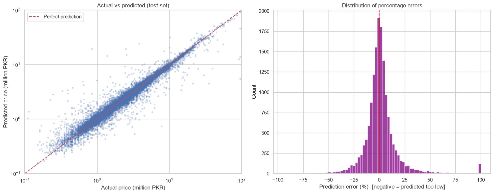
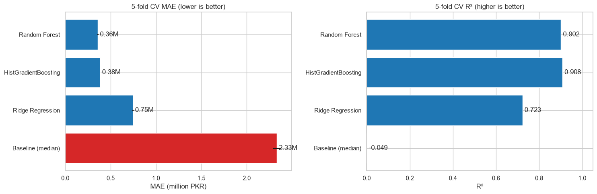
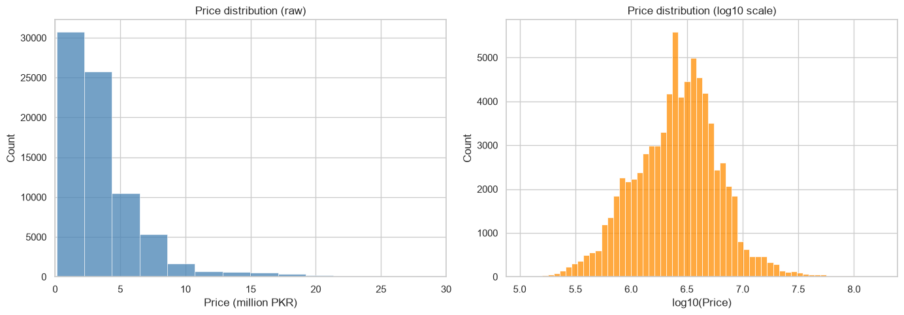
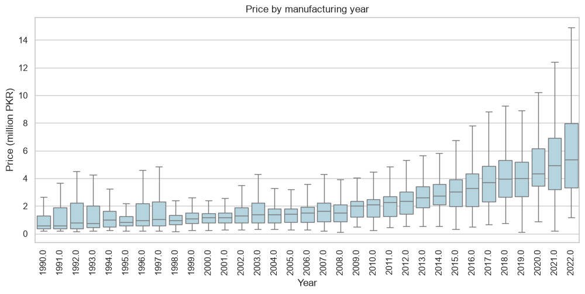
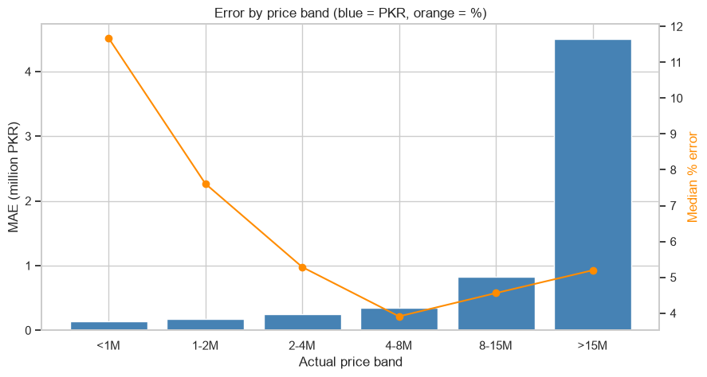
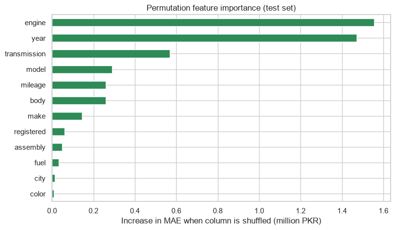

# Used Car Price Prediction in Pakistan (PakWheels)

A Module 3 machine learning project that predicts the asking price of a used car in Pakistan from about 77,000 PakWheels ads.



## Problem statement

**Predict** the asking price (PKR) of a used car **for** buyers and sellers on PakWheels **using** the car's make, model, year, engine size, mileage, transmission, fuel type, body type, assembly, colour, city and registration city, **so that** a seller can set a fair price for an ad and a buyer can tell when a listed price is too high.

- **Type:** regression (the label `price` is a number)
- **Metrics:** MAE (average rupees off per car) and R²

## Results

| Model | 5-fold CV MAE (PKR) | 5-fold CV R² |
|---|---:|---:|
| Baseline (always predicts the median price) | 2,332,394 | -0.05 |
| Ridge Regression | 747,867 | 0.72 |
| **Random Forest (chosen)** | **360,379** | **0.90** |
| HistGradientBoosting | 384,307 | 0.91 |

**Random Forest on the held-out test set (15,418 ads):**

- **MAE:** 367,008 PKR, 84% lower than the baseline
- **R²:** 0.83
- **Close predictions:** 69% of ads within 10% of the real price, and 87% within 20%

I chose Random Forest because it has the lowest MAE, which is what matters most to a buyer or seller. Its R² is almost the same as HistGradientBoosting. Test MAE is close to CV MAE, so the model is not overfitting.



## Dataset

- **Source:** PakWheels used car listings (Kaggle: *Pakistan Used Car Prices 2023*)
- **File:** `pakwheels_used_car_data_v02.csv`, 77,878 rows × 14 columns
- **Columns:** `addref, city, assembly, body, make, model, year, engine, transmission, fuel, color, registered, mileage, price`

I used the v02 file because the other version of the dataset had a broken `year` column (every row said 1905).

## Approach

1. **Data:** load the file and check its shape, column types, missing values and duplicates.
2. **Row-level cleaning:** fill a blank `assembly` with "Local", drop rows with no price, drop impossible engine sizes and one 529M PKR price typo, and group colour spellings. Nothing here is learned from the data, so it is safe to do before the split.
3. **EDA:** look at the price distribution and at price by year, make, mileage, transmission, assembly and fuel, plus a correlation heatmap.
4. **Split and baseline:** 80/20 train/test split (`random_state=42`), then a median `DummyRegressor` as the baseline.
5. **Pipeline (no leakage):** a `ColumnTransformer` imputes missing values (median / "Unknown"), one-hot encodes categories (rare ones grouped together) and scales numbers. `TransformedTargetRegressor` trains on `log(price)`.
6. **Model comparison:** Ridge, Random Forest and HistGradientBoosting compared with 5-fold CV on the training set only.
7. **Evaluation:** test MAE and R², actual vs predicted, errors by price band, the worst predictions, and permutation feature importance.

| Price is skewed, so I model log(price) | Newer cars cost much more |
|---|---|
|  |  |

## What the model gets wrong



- **Wrong prices in ads:** some ads have typos or fake prices, so the "true" label itself is wrong.
- **Few luxury cars:** there is little data above 15M PKR, so the errors there are large in rupees.
- **No trim or condition data:** a Corolla GLi and an Altis look the same to the model.
- **Old cheap cars:** their price depends on condition, which the data doesn't record, so they have the highest % error (about 12%).



Engine size and year matter most, then transmission, model and mileage.

## Repository contents

| File | What it is |
|---|---|
| `PakWheels_Price_Prediction.ipynb` | Full notebook, run from top to bottom with all outputs |
| `pakwheels_used_car_data_v02.csv` | Dataset |
| `PakWheels Used Car Price Prediction.pptx` | Presentation slides |
| `images/` | Charts exported from the notebook |
| `requirements.txt` | Python packages |

## How to run

**In Google Colab (easiest):** click the badge below, then choose **Runtime › Run all**. The notebook reads the CSV straight from this repo, so you don't need to upload anything.

[](https://colab.research.google.com/github/saddamkhan11/pakwheels-car-price-prediction/blob/main/PakWheels_Price_Prediction.ipynb)

**On your own computer:**

```bash
pip install -r requirements.txt
jupyter notebook PakWheels_Price_Prediction.ipynb
```

Then choose **Run All**. The full run takes about 10 minutes, mostly for Random Forest cross-validation.

## Next steps

- Use stricter rules to remove wrong prices
- Add trim/variant and condition features
- Tune hyperparameters with `GridSearchCV` on the training set
